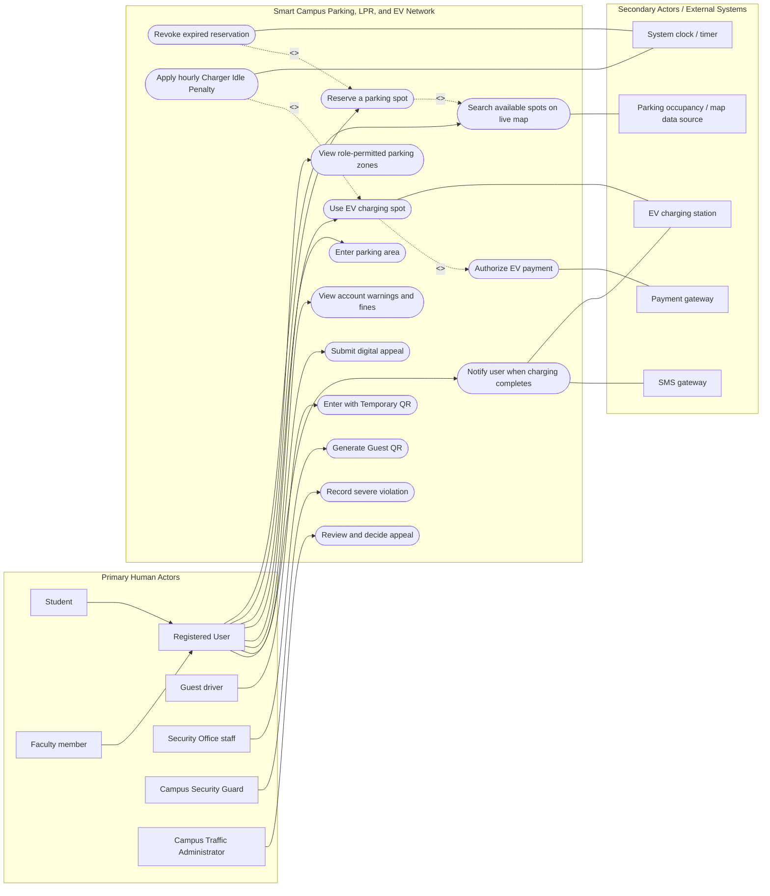

# Requirements Architecture & System Specification

**Course:** Software Engineering Methods  
**System:** Smart Campus Parking, LPR, and EV Network  

### Engineering Team Details

- **Student 1:** Oran Cohen | **ID:** 324155845 | **Braude Email:** oran.cohen@e.braude.ac.il
- **Student 2:** Amit Asaf | **ID:** 207659087 | **Braude Email:** amit.asaf@e.braude.ac.il
- **Student 3:** Yasmin Askarov | **ID:** 323017012 | **Braude Email:** yasmin.askarov@e.braude.ac.il
- **Student 4:** Lihi Elias | **ID:** 319041109 | **Braude Email:** lihi.elias@e.braude.ac.il

---

## 1. System Use Case Diagram (Mermaid.js)

<!--
INSTRUCTIONS FOR STUDENTS:
1. Populate the Mermaid flowchart below based on your audited entities from Part 1, Step 4.
2. Group human actors inside Primary_Actors and hardware/external systems inside Secondary_Actors.
3. Place all core Use Cases inside the ParkingSystem boundary subgraph.
4. Use solid lines without arrows (---) for Actor associations.
5. Use dashed arrows with explicit stereotypes for dependencies:
   - Include: BaseUC -.->|"<<include>>"| IncludedUC
   - Extend:  ExtendingUC -.->|"<<extend>>"| BaseUC
-->

---

## 2. Business Edge Cases & Concurrency Decisions

<!--
INSTRUCTIONS FOR STUDENTS:
Select at least two unresolved business ambiguities, concurrency edge cases, or hardware timeouts
identified during your AI auditing phase. Document your architectural decision in English below.
-->

### Edge Case 1: Concurrent Parking Spot Reservation

- **Scenario & Ambiguity:** Two registered users open the live map simultaneously, see the exact same available parking spot, and click "Reserve" at the exact same millisecond.
- **Architectural Resolution:** The system shall implement pessimistic locking on the database record for that specific parking spot. The first request to reach the database acquires the lock and successfully reserves the spot. The second concurrent request is immediately rejected with an "Already Reserved" error, prompting the user's map to refresh.
- **Impact on System State:** The target spot's database status changes from 'Available' to 'Reserved'. A 15-minute expiration timer is initialized for the successful user. The failed user's account state remains unchanged.

### Edge Case 2: EV Unplugged but Vehicle Not Moved

- **Scenario & Ambiguity:** An EV reaches 100% charge, the 30-minute grace period expires, and the penalty begins. The user arrives and unplugs the charging cable to stop the session, but leaves the vehicle physically parked in the EV spot to attend a class.
- **Architectural Resolution:** The "Charger Idle Penalty" rule logic shall be tied to physical spot occupancy, not just the charging cable connection. Unplugging the cable ends the electrical transaction, but the 5 NIS/hour penalty continues to accrue until the LPR exit camera or spot occupancy sensor confirms the vehicle has physically vacated the space.
- **Impact on System State:** The active charging session ends in the payment gateway, but the system continues to append the 5 NIS/hour fee to the user's billing account ledger until physical departure is logged.

---

## 3. Requirements Traceability Matrix (RTM)

<!--
INSTRUCTIONS FOR STUDENTS:
1. Formulate atomic, single-responsibility requirements using RFC 2119 ("shall") and EARS syntax.
2. Maintain the starter rows below and ADD at least:
   - 2 more Functional Requirements (FR) to reach a total of at least 3 FRs.
   - 2 more Non-Functional Requirements (NFR) to reach a total of at least 3 NFRs.
3. Every NFR MUST contain an explicit, measurable numeric threshold or SLA latency limit.
-->

Action 1: Resource Allocation for a Task & Reporting Task Completion

Functional Requirements (FR):

FR1.1: The system shall allow a Dispatcher to allocate a predefined resource package to a task currently in the 'Ready' state, executing the request as a single atomic SQL transaction.
FR1.2: The system shall immediately release all resources associated with a task (returning their status to 'Available') once the assigned Field Commander reports the task as 'Completed'.
FR1.3: The system shall automatically block the resource allocation process and abort the transaction if even one resource within the requested package is unavailable.

Non-Functional Requirements (NFR):

NFR1.1 : The system shall execute a resource allocation as a single SQL transaction, ensuring a 100% rollback if even 1 requested resource is unavailable, to prevent partial bookings.
NFR1.2 : The system shall push real-time status updates of the allocation to all relevant client stations immediately, requiring exactly 0 polling requests from the clients. 
NFR1.3 : The system shall mandate that 100% of users, including the Dispatcher performing the allocation, are authenticated via username and password before granting access.  
NFR1.4 : The system shall support concurrent dispatcher actions exclusively over a Local Area Network (LAN) utilizing the OCSF framework over TCP/IP, without using a Web-based interface.

Action 2: Time Compliance and SLA Report Generation

Functional Requirements (FR):

FR2.1: The system shall automatically generate the SLA report exactly at the end of each month, triggered internally by the system clock.
FR2.2: The system shall allow a System Administrator to manually generate an SLA report on-demand for any 1 selected past month.
FR2.3: The system shall calculate the SLA metric by computing the average time elapsed from the opening of an event until the closure of the last task within that event, grouped strictly by event types.

Non-Functional Requirements (NFR):

NFR2.1 : The system shall restrict access to ensure that 100% of SLA report generation and viewing actions are permitted exclusively to the "System Administrator" role, blocking the other 4 user roles.
NFR2.2 : The system's reporting module architecture shall be designed to ensure that adding any new report type in the future requires minimal development effort.
NFR2.3 : The system's graphical interface shall present the SLA report clearly segmented into exactly 5 distinct visual categories, strictly corresponding to the predefined closed list of event types.
NFR2.4 : The system shall extract the timestamps for the SLA calculations exclusively from the system's Audit Log, relying on its 100% read-only chronological records of event openings and task state changes.

| Req ID     | Requirement Description (Clean English with "shall")                                                                                                                                                     | Type (FR/NFR) | Mapped Use Case | Test ID |
| :--------- | :-----------------------------------------------------------------------------------------------------------------------------                                                                           | :-----------: | :-------------- | :-----: |
| **REQ-01** | The system shall allow a Dispatcher to allocate a predefined resource package to a task currently in the 'Ready' state, executing the request as a single atomic SQL transaction.                        |      FR       | UC_ReserveSpot  | TEST-01 |
| **REQ-02** | The payment gateway authorization shall return a verification token within a maximum latency of 2.5 seconds under peak load.                           |      NFR      | UC_ChargeEV     | TEST-02 |
| **REQ-03** | The system shall apply a charger idle penalty of 5 NIS per hour starting 30 minutes after 100% charging completion.                                    |      FR       | UC_ChargeEV     | TEST-03 |
| **REQ-04** | The system shall apply dynamic filtering on the live map to restrict Students to "Student Zone" spots while allowing Faculty to see all zones.         |      FR       | UC_SearchSpot   | TEST-04 |
| **REQ-05** | The system shall allow the Campus Traffic Administrator to manually review and either approve or reject a user's Digital Appeal.                       |      FR       | UC_AppealFine   | TEST-05 |
| **REQ-06** | The EV charging component shall monitor battery status with a precision threshold of exactly 100% complete before triggering the SMS notification.     |      NFR      | UC_ChargeEV     | TEST-06 |
| **REQ-07** | The mobile terminal shall support the documentation of a Severe Violation based on the physical spatial threshold of a vehicle occupying 2 lines.      |      NFR      | UC_LogViolation | TEST-07 |

---

## 4. BDD Acceptance Tests (Given-When-Then)

<!--
INSTRUCTIONS FOR STUDENTS:
Author two complete BDD acceptance tests corresponding to the Test IDs in your RTM table.
- Test 1: Happy Path Operational Flow.
- Test 2: Exception, Fault, or Automated Penalty Flow.
-->

### Acceptance Test [TEST-01]: LPR Successful Gate Entry (Happy Path)

- **Given:** A student has an active parking permit and their vehicle approaches the entrance gate.
- **When:** The LPR camera successfully scans and matches the registered license plate.
- **Then:** The system must send an automated command to open the barrier gate.
- **And:** The system must record the exact entry timestamp in the access audit log.

### Acceptance Test [TEST-03]: Charger Idle Penalty Enforcement (Exception / Timeout)

- **Given:** An electric vehicle has reached 100% battery charge at an EV terminal and an SMS alert was dispatched.
- **When:** Exactly 30 minutes and 1 second elapse without the charging cable being disconnected and vehicle moved.
- **Then:** The system must start accruing an idle penalty fee of 5 NIS per hour.
- **And:** The accrued fee must be automatically attached to the owner's billing account ledger.

### Acceptance Test [TEST-04]: Dynamic Map Filtering for Students (Happy Path)

- **Given:** A registered Student is logged into the system and opens the live map to search for available parking spots.

- **When:** The system retrieves the available parking inventory and applies dynamic role-based filtering.

- **Then:** The live map must display only available spots that are located within the "Student Zone".

- **And:** The system must hide all other parking zones from the student's view.

### Acceptance Test [TEST-01]: Reservation Revocation and No-Show Warning (Exception / Penalty Flow)

- **Given:** A registered user has reserved a parking spot and the 15-minute reservation timer has been initiated.

- **When:** Exactly 15 minutes elapse and the LPR camera has not detected the reserved vehicle entering the specific parking zone.

- **Then:** The system must automatically revoke the parking reservation.

- **And:** The system must flag the user's account with a "No-Show" warning

---

## 5. Pre-Submission Self-Audit Checklist

Before compressing your final ZIP archive (`ex1_ID1_ID2.zip`), verify compliance:

- [ ] All sections of this document are completed exclusively in professional English.
- [ ] The Mermaid diagram renders without errors in IntelliJ's Split Preview window.
- [ ] Dependencies (`<<include>>` and `<<extend>>`) have arrows pointing in the architecturally correct directions.
- [ ] At least two resolved business edge cases are documented with state impact.
- [ ] The RTM contains at least 3 FR and 3 NFR rows, with all NFRs having explicit numeric thresholds.
- [ ] Acceptance Test IDs (`TEST-XX`) strictly match the corresponding entries in the RTM table.
